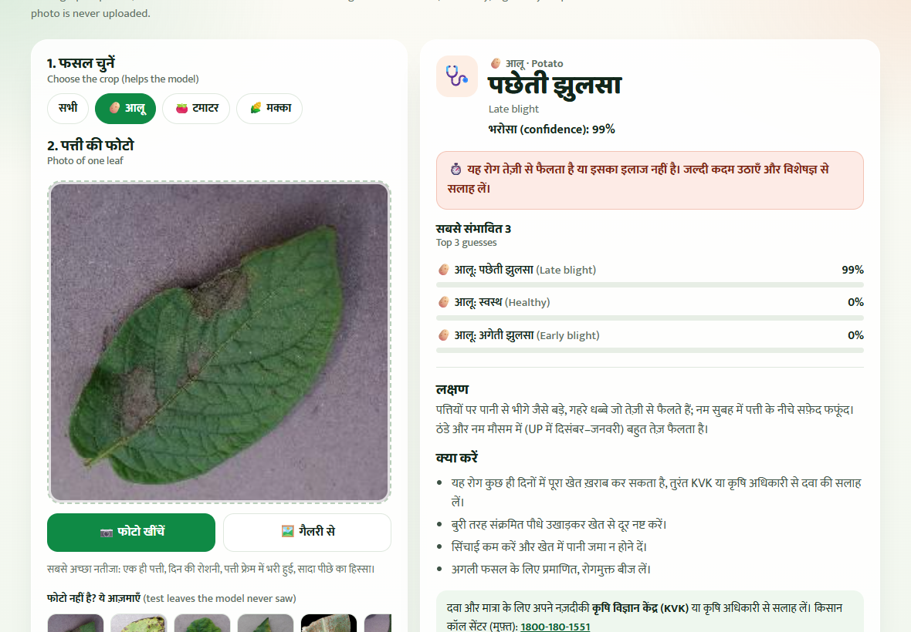
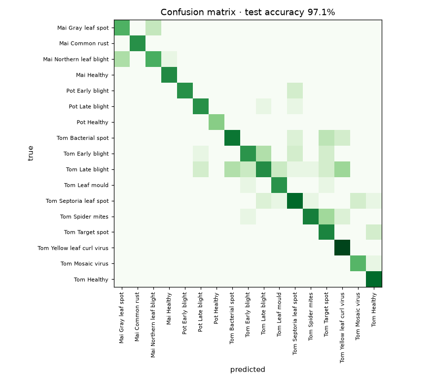

# Fasal Doctor (फसल डॉक्टर)

**Take a photo of a potato, tomato or maize leaf, and a neural network tells you which of 17 diseases (or healthy) it looks like, with simple Hindi advice.** It runs entirely on the phone: the photo is never uploaded.

**Live demo:** https://khetgo-app.vercel.app/fasal-doctor/ · part of [KhetGo](https://khetgo-app.vercel.app), a farm-machine booking app for Uttar Pradesh.



## Results

| | |
|---|---|
| Test accuracy, on leaves the model never saw | **97.1%** (3,876 photos) |
| Same, counting only photos with an exact leaf ID | 97.3% |
| Classes | 17 (potato 3, tomato 10, maize 4) |
| Model | MobileNetV3-Large, 16.9 MB ONNX |
| Hardest classes | tomato late blight (81.7%), maize northern leaf blight (86.3%), tomato early blight (89.9%) |



## Why the test is honest

PlantVillage has about **four photos of each physical leaf**. A random train/test split puts photos of the same leaf on both sides, so the model is partly tested on leaves it has already seen, and the score is inflated.

Here the split is **by leaf**:
- For 62% of photos, the dataset authors' `leaf-map.json` gives the real leaf ID.
- For the rest (all maize, mosaic virus and some tomato sources), photos are grouped in blocks of 50 consecutive photo numbers, because photos of one leaf are taken one after another. On the mapped photos this keeps about 90% of leaves entirely inside one block.

Train / validation / test = 70 / 15 / 15% of leaves, per class. The script asserts that no leaf group appears in both train and test.

## How it works

1. **Data:** 24,164 PlantVillage colour photos of potato, tomato and maize leaves.
2. **Transfer learning (PyTorch, laptop CPU):** MobileNetV3-Large pretrained on ImageNet. First only a new 17-class head is trained on frozen features, then the last blocks are fine-tuned. Augmentation (random crops, flips, rotation, colour jitter) helps with phone photos.
3. **Export:** ONNX, checked against PyTorch on test images.
4. **Browser app:** ONNX Runtime Web (WebAssembly). The photo is centre-cropped and resized to 224 × 224 (large photos are halved step by step to avoid aliasing), and the prediction is averaged with its mirror image.
5. **Crop filter:** if the farmer picks the crop, only that crop's diseases are considered.
6. **Safety in the interface:** below 60% confidence it asks for a clearer photo; advice is general and non-chemical, and points to the local KVK / agriculture officer and the Kisan Call Centre (1800-180-1551) for medicines.

## Limitations

- PlantVillage photos are single leaves on a plain background, taken in a lab setting. Research (e.g. Mohanty et al., 2016) shows accuracy drops sharply on real field photos with clutter, so this is a first hint, not a diagnosis.
- It only knows these three crops. Any other photo still gets one of these 17 answers (the low-confidence warning helps, but is not a guarantee).
- Collecting labelled photos from fields in Uttar Pradesh is the obvious next step.

## Run it yourself

```bash
# 1. Data: sparse checkout of PlantVillage (only potato, tomato, maize) into data/pv
git clone --filter=blob:none --no-checkout https://github.com/spMohanty/PlantVillage-Dataset data/pv
cd data/pv && git sparse-checkout set --no-cone "/raw/color/Potato___*" "/raw/color/Tomato___*" "/raw/color/Corn_(maize)___*" && git checkout && cd ../..
curl -L -o data/leaf-map.json https://raw.githubusercontent.com/spMohanty/PlantVillage-Dataset/master/leaf_grouping/leaf-map.json

# 2. Train (about 40 minutes on an 8-thread laptop CPU), writes web/model and docs/
pip install torch torchvision onnx onnxruntime matplotlib pillow
python training/train.py

# 3. Serve the web app
cd web && python -m http.server 8000
```

## Project structure

```
training/train.py          data, leaf-level split, training, evaluation, ONNX export
training/pick_samples.py   copies a few test-split leaves for the demo page
web/                       the app (index.html, app.js, advice.js, model/, samples/)
docs/                      confusion matrix, class counts, metrics
```

## Credits and licence

- **Data:** PlantVillage dataset, Hughes & Salathé (2015), *An open access repository of images on plant health to enable the development of mobile disease diagnostics*, arXiv:1511.08060. Licensed **CC BY-SA 3.0**.
- Because the model and sample images are derived from PlantVillage, they are shared under **CC BY-SA 3.0** too. The code is MIT licensed.
- Built by [Priyanshu Zihowa](https://priyanshu-zihowa.vercel.app) with Claude Code.
